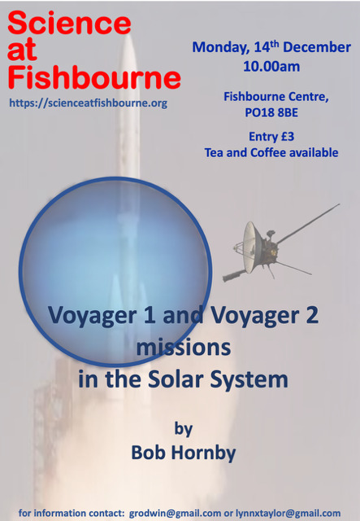

::: {.img-float}
{width=30% fig-alt="Poster image for talk entitled Voyager 1 and Voyager 2 missions in the Solar System" style="float: right; margin: 5px;"}
:::

# Overview

The Voyager missions are two of the most important space explorations in history.

The Voyager program has done things no one predicted, found scenes no one expected and promises to outlive its inventors.

Like a great painting or an abiding institution, the Voyager spacecraft have acquired an existence of their own, a destiny beyond the grasp of its handlers.

What are they and where are they; all will be revealed.
