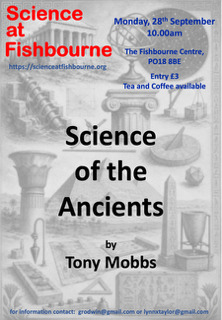

::: {.img-float}
{width=30% fig-alt="Poster image for talk entitled Science of the Ancients" style="float: right; margin: 5px;"}
:::

# Overview

Science played a significant role in the development of early ancient civilisations and how engineering helped produce their temples and monuments. However recent discoveries have raised inconsistencies that challenge all we have learnt about ancient history

# Lynn's Review

Coming soon...
