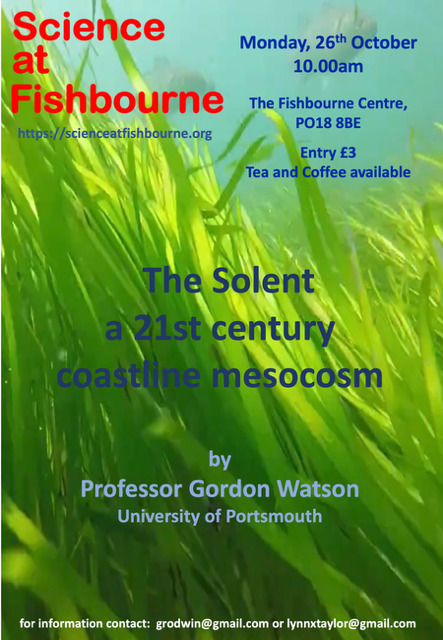

::: {.img-float}
{width=30% fig-alt="Poster image for talk entitled The Solent: A 21st Century Coastline Mesocosm" style="float: right; margin: 5px;"}
:::

# Overview

A **mesocosm** is a medium sized experimental tool or enclosed system that models a natural ecosystem under controlled conditions.

# Lynn's Review


