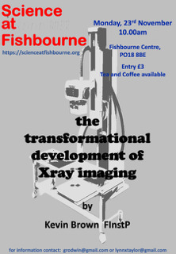

::: {.img-float}
{width=30% fig-alt="Poster image for talk entitled The transformational development of X-ray imaging" style="float: right; margin: 5px;"}
:::

# Overview

X-ray imaging is an enormous topic but Kevin has had the privilege to be exposed to some small steps in its development. He will talk about how X-ray imaging has developed from the blurry images that resulted in the discovery of X-rays to the high performance diagnostic imaging of today. The talk will also cover some of its applications.

# Lynn's Review

Coming soon...
